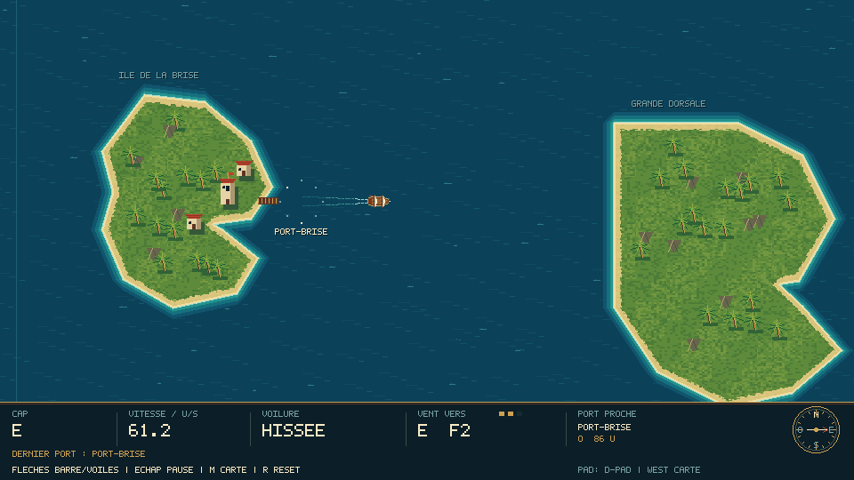

# Pirates Reborn

Jeu indépendant en Rust sur [gotoo-pixel-engine (GPE)](https://github.com/gotoo77/gotoo-pixel-engine), héritier spirituel de **Pirates! sur Amstrad CPC**. Liberté de navigation, exploration maritime et aventure émergente constituent le cœur du projet. À terme, commerce, ressources, ports, factions, réputation, diplomatie, rencontres et carrière du capitaine pourraient se nourrir mutuellement : la profondeur doit venir des interactions entre systèmes simples.

Carte, graphismes, textes et données seront originaux. Aucun code ou asset propriétaire n'est repris ; une image DSK n'est pas nécessaire.

## Statut

**P1.1 — Maritime Visual & Gameplay Feel implémenté localement**, sur `feat/p1-maritime-navigation`, après P1 (`84e869e`). Prototype : quitter Port-Brise, contourner Grande Dorsale avec le vent, atteindre Port-Phare ou Port-Anse, puis repartir. Aucun commerce, combat ou contenu P2.

La dépendance GPE est verrouillée au commit **`8cbceda0c9b0cc55ee5deb7d5e173676ffc1d4f1`**, package 0.2.0. Le tag Git `v0.2.0` désigne un autre commit et n'est pas utilisé. Aucun moteur local ou autre jeu n'est modifié.

Le [rapport P1.1](docs/p11-validation.md) présente les captures, les performances et les validations ; le [rapport P1](docs/p1-validation.md) conserve la référence historique. Aucun push ou merge n'est effectué.

## Documents

- [Analyse du jeu de référence](docs/reference-analysis.md) : faits documentés, déductions, propositions et limites des sources CPC.
- [Audit GPE](docs/gpe-capability-audit.md) : révisions, API et fichiers inspectés, conventions, contraintes et conditions de démarrage.
- [Spécification P1](docs/p1-navigation-spec.md) : petite traversée jouable, vent, contrôles, collisions et critères mesurables.
- [Roadmap](docs/roadmap.md) : P0 à P5 ; P2 et suivantes restent des hypothèses.

## Jouer en natif

Prérequis : Rust **>=1.97.1** (édition 2024), Cargo, rustfmt, Clippy ; Linux avec `pkg-config`, `libasound2-dev`, `libudev-dev` et un affichage/GPU accessible.

```bash
cargo build --locked --release
cargo run --locked --release --bin pirates-reborn
```

Le binaire est aussi lançable directement : `./target/release/pirates-reborn`. Framebuffer **960 × 540**, fenêtre initiale **1440 × 810**, ratio conservé et filtrage nearest. Le HUD occupe les 88 dernières lignes. La caméra suit le bateau sur la carte 1600 × 1000 et garde une marge visuelle aux limites du monde. Les règles et la coque physique ne sont pas agrandies. Le mode 1280 × 720 a été comparé puis écarté : coût supérieur et repères plus petits à fenêtre égale, sans détail supplémentaire sur le voilier. Voir les mesures du rapport.

| Action | Clavier | Manette sélectionnée |
| --- | --- | --- |
| Tourner | Flèches gauche / droite | D-pad gauche / droite ou stick X (seuil ±0,35) |
| Hisser / baisser | Flèches haut / bas | D-pad haut / bas |
| Pause / reprise | Échap | Start |
| Carte générale / retour | M ; Échap ferme aussi | West (bouton de face gauche) ; Start ferme aussi |
| Recommencer | R | Select |

Fermer la fenêtre quitte le jeu. Hisser les voiles démarre ; entrer dans le disque d'un port depuis l'extérieur baisse les voiles. Le vent souffle **vers l'est**, force 2 : un cap SE ou NE atteint 72 unités/s ; travers 57,6 ; face au vent 10,8. Face à la terre, tout le déplacement du tick est refusé : tourner puis repartir. Route possible : depuis Brise, cap SE jusqu'au sud de Dorsale, puis E et N vers Phare.

La manette connectée d'identifiant minimal est choisie et conservée jusqu'à déconnexion. Le clavier est prioritaire, puis le D-pad, puis le stick. Le navigateur peut demander une première pression de bouton pour exposer une manette. **Le matériel réel reste à tester.** Il n'y a pas de pause automatique promise à la perte de focus : utiliser Échap/Start.

## Construire et servir le Web

Prérequis supplémentaires : cible `wasm32-unknown-unknown`, CLI **wasm-bindgen 0.2.127** correspondant au lockfile, Python 3 et navigateur WebGPU. Installer la cible si nécessaire :

```bash
rustup target add wasm32-unknown-unknown
cargo install wasm-bindgen-cli --version 0.2.127 --locked
python3 -B scripts/package_web.py
python3 -m http.server 8000 --bind 127.0.0.1 --directory dist
```

Ouvrir `http://127.0.0.1:8000`, puis cliquer sur le canvas. Le script construit `examples/pirates_web.rs` en release locked, exécute `wasm-bindgen --target web` et copie HTML/chargeur dans `dist/` (ignoré par Git). Le paquet comprend `pirates.js`, `pirates_bg.wasm` et les snippets générés. Aucun serveur ou déploiement n'est lancé par le packaging. La réussite du packaging ne suffit pas à prouver le fonctionnement d'un navigateur quelconque.

## Présentation et règles P1.1

Rendu original dessiné en pixels dans le jeu : mer bleu pétrole et turquoise, vagues discrètes, sillage des déplacements réellement acceptés, plages ivoire, baies, palmiers, rochers, bâtiments aux toits rouges et quais. Les références `pirates_1.png` à `pirates_4.png` fournies par le propriétaire inspirent palette et matières ; elles ne sont pas embarquées ni copiées. Le petit navire à deux mâts, pavillon rouge et voiles ivoire mesure 26 pixels de coque et possède 16 orientations avec deux états de voilure. Sa collision reste un carré de demi-largeur 6.

Les quatre îles restent dans leurs enveloppes P1 ; leurs nouveaux contours sont des unions de polygones fixes partagés par le dessin et les collisions. Le sable est solide ; le liseré turquoise/écume est de l'eau. Les quais et bouées sont des repères visuels sans nouvel obstacle, comme en P1. Les trois disques d'arrivée sont inchangés. Aucun moteur de terrain, asset propriétaire, audio ou contenu P2.

La carte affiche tout le monde, les quatre îles, les trois ports et le navire orienté. **Elle suspend entièrement les ticks et les animations.** Fermer conserve une pause qui préexistait ; sinon la navigation reprend sans rattraper le temps passé sur la carte. Le bateau conserve alors son cap et sa voilure. Les commandes nautiques restent ignorées jusqu'au relâchement des flèches/D-pad et au retour du stick dans la zone neutre ; le HUD l'indique. Les ordres en attente à l'ouverture sont supprimés. R ferme la carte et réinitialise la partie.

La règle pure (`src/navigation.rs`) utilise 16 caps et 1024 sous-unités, un tick de 20 ms, la polaire fixée en P0 et des collisions balayées rationnelles. `src/app.rs` conserve les ordres ponctuels jusqu'au tick et adapte les entrées GPE ; `src/draw.rs` ne modifie pas la simulation. Pas d'abstraction pour P2.



[Avant P1](docs/screenshots/p1-web-1x.png) · [Carte P1.1](docs/screenshots/p11-chart-960.png) · [16 caps et deux voilures](docs/screenshots/p11-ship-16-headings.png)

## Actualiser et compiler

Depuis la racine :

```bash
./up.sh
```

Depuis un autre répertoire :

```bash
/home/gduval/dev/gpe_pirates_reborn/up.sh
```

Le script se place dans son propre répertoire, inspecte Git avant toute mise à jour et refuse les modifications suivies, indexées, non suivies ou dans les sous-modules. Les fichiers ignorés, dont `target/`, ne rendent pas le dépôt sale. Il refuse aussi HEAD détachée, dépôt sans commit, suivi absent ou local, et opérations Git en cours.

Il conserve la branche et lance `git pull --ff-only --no-rebase`, en désactivant l'autostash pour cette commande. Une divergence ou une erreur réseau interrompt le script. Il vérifie à nouveau la branche et l'état local avant de compiler.

Si `Cargo.toml` existe après la mise à jour, il exécute **`cargo build --locked --release`** et propage toute erreur. Le cache Cargo est conservé ; pas de `cargo clean`. Sans manifeste, il affiche **« compilation indisponible »** et termine avec le code 0 pour la seule actualisation Git réussie. Il ne crée aucun projet ni lockfile. Il ne pousse rien, ne change pas de branche et n'effectue ni stash, ni reset, ni rebase, ni commit de merge. Une compilation échouée ne défait pas un fast-forward déjà effectué.

Pendant cette livraison locale P1.1, les modifications non commitées font légitimement refuser le script avant le pull. Ses quatorze tests d'intégration isolés sont conservés. Le parcours end-to-end du vrai script sur une branche propre reste à effectuer après publication explicitement autorisée. Ne pas lancer le script en même temps qu'une autre opération modifiant le dépôt.

`up.sh` sert à actualiser et compiler ; il ne remplace pas les tests et Clippy.

### Windows 11 natif (PowerShell)

Prérequis : Git pour Windows et Rust MSVC >=1.97.1 installés, avec les outils de compilation Visual Studio requis par Rust. Depuis le dépôt, construire/lancer sans mise à jour :

```powershell
cargo build --locked --release
.\target\release\pirates-reborn.exe
# ou : cargo run --locked --release --bin pirates-reborn
```

Pour actualiser une copie **propre**, `up.ps1` offre les mêmes protections et la même compilation que `up.sh`. Il localise le dépôt depuis le script et restaure le répertoire appelant, même sur erreur. Depuis PowerShell :

```powershell
.\up.ps1
# Depuis un autre répertoire :
& 'C:\chemin\vers\gpe_pirates_reborn\up.ps1'
# Si nécessaire, autorisation limitée à ce processus :
powershell.exe -NoProfile -ExecutionPolicy Bypass -File .\up.ps1
```

Le pull est fast-forward uniquement, avec rebase/autostash désactivés. Les codes de retour Git et Cargo sont vérifiés explicitement ; aucune compilation après erreur. Le cache Cargo est conservé. Sans `Cargo.toml` après un pull réussi, le script signale la compilation indisponible et termine avec 0, comme Bash.

Les protections PowerShell sont testables sans toucher au dépôt de travail :

```powershell
py -3 -B -m unittest discover -s tests -p test_up_ps1.py -v
```

Ces 16 essais utilisent des dépôts temporaires et un enregistreur Cargo. **Ils ne sont pas exécutés dans cette session : aucun environnement PowerShell utilisable.** Ils s'exécutent automatiquement si `pwsh` ou `powershell` est disponible ; sinon le résultat est un skip explicite. Le jeu Windows 11 natif et la manette physique restent à vérifier par le propriétaire.

## Validation

Commande canonique, incluant **Clippy strict natif et WASM**, release, packaging Web, tests Bash/Python et chargeur JS :

```bash
bash scripts/check.sh
```

Node.js est requis seulement pour le test du chargeur Web. Les tests de `up.sh` utilisent Python standard, Bash, Git et des dépôts temporaires, sans réseau. Détails de chaque commande, captures, comparaison native/WASM et limites : [rapport P1.1](docs/p11-validation.md).

Mesurer séparément le coût CPU des ticks et du dessin : `cargo run --locked --release --example measure`. Ce résultat n'est pas une mesure GPU ni un jugement de plaisir de navigation.

Captures CPU reproductibles sans nouvelle dépendance : `cargo run --locked --release --example capture` (PPM dans `target/captures/`). Les captures de fenêtre et de navigateur sont des essais distincts.
